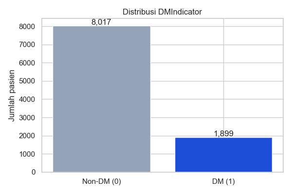
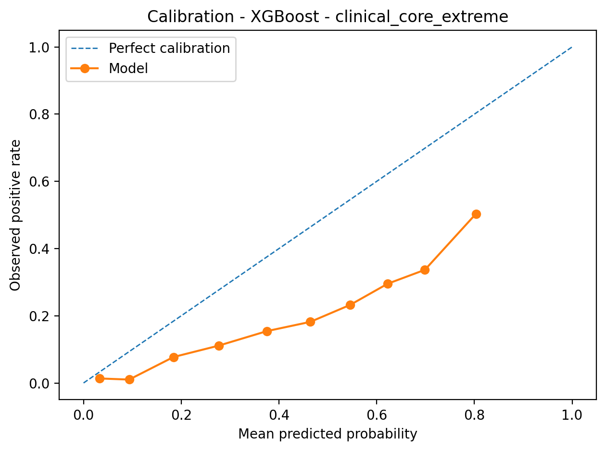
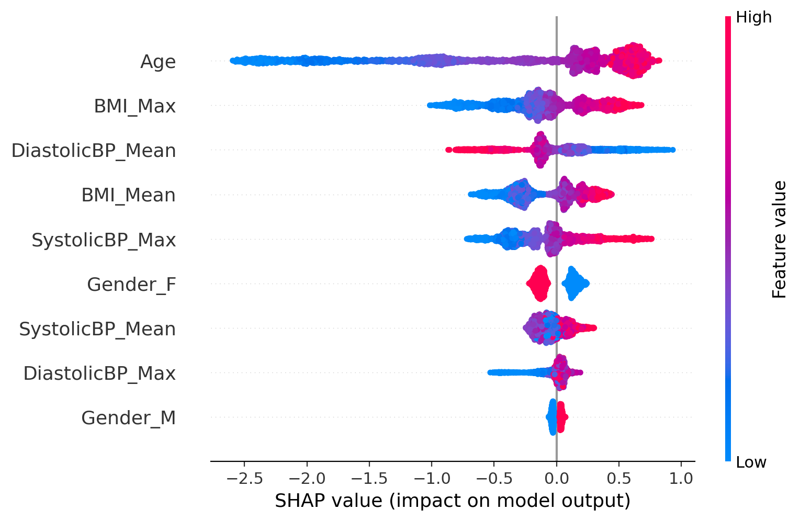

# Klasifikasi Status Diabetes Melitus Tipe 2 Berbasis EHR

Repository ini berisi source code, dokumentasi metodologi, dan ringkasan hasil penelitian klasifikasi status Diabetes Melitus Tipe 2 (T2DM) menggunakan data Electronic Health Record (EHR) Practice Fusion.

Penelitian ini diposisikan sebagai klasifikasi status T2DM, bukan prediksi kejadian diabetes di masa depan. Dataset tidak menyediakan tanggal diagnosis pertama yang cukup jelas untuk membentuk observation window dan prediction window secara valid.

## Ringkasan Penelitian

- Target: status T2DM.
- Primary metric pemilihan model: PR-AUC.
- Pembagian data: 70% development dan 30% locked test secara stratified.
- Seluruh pemilihan feature set, model, strategi imbalance, hyperparameter, dan threshold dilakukan pada development data.
- Locked test digunakan satu kali untuk evaluasi final setelah keputusan model dikunci.
- Feature set utama: `clinical_core_extreme` dengan delapan fitur konseptual.
- Model final penelitian: weighted XGBoost dengan hyperparameter hasil Optuna dan threshold `0.35`.

## Alur Penelitian

1. Audit dan integrasi sumber data EHR.
2. Pembentukan final dataset.
3. Exploratory Data Analysis (EDA).
4. Pemeriksaan metodologi dan potensi leakage.
5. Screening feature set.
6. Perbandingan enam algoritma.
7. Perbandingan strategi penanganan class imbalance.
8. Hyperparameter tuning.
9. Threshold tuning pada out-of-fold development predictions.
10. Evaluasi satu kali pada locked test.
11. Error analysis dan interpretasi model menggunakan SHAP.

## Feature Set Utama

Feature set `clinical_core_extreme` menggunakan:

- Age
- Gender
- BMI mean
- BMI maximum
- Systolic blood pressure mean
- Systolic blood pressure maximum
- Diastolic blood pressure mean
- Diastolic blood pressure maximum

Model utama tidak menggunakan `PatientGuid`, `PracticeGuid`, lokasi, physician specialty, diagnosis/ICD, atau medication sebagai predictor. Kolom tersebut hanya dipertahankan bila diperlukan untuk metadata, audit, atau sensitivity analysis.

## Distribusi Target dan EDA

Visualisasi EDA lainnya tersedia di [`final_outputs/02_eda/plots/`](final_outputs/02_eda/plots/).

## Perbandingan Model pada Development CV

Hasil berikut berasal dari 5-fold stratified cross-validation pada development data dengan feature set `clinical_core_extreme`.

| Model | PR-AUC | ROC-AUC | Recall | F2 |
|---|---:|---:|---:|---:|
| XGBoost | 0.4393 | 0.7740 | 0.7194 | 0.5886 |
| Gradient Boosting | 0.4269 | 0.7719 | 0.7276 | 0.5915 |
| LightGBM | 0.4216 | 0.7648 | 0.6576 | 0.5605 |
| Logistic Regression | 0.4175 | 0.7742 | 0.7103 | 0.5882 |
| SVM | 0.4153 | 0.7738 | 0.7427 | 0.6031 |
| KNN | 0.3756 | 0.7332 | 0.1798 | 0.2045 |

Detail lengkap: [`final_outputs/05_model_comparison/main_cv_summary.csv`](final_outputs/05_model_comparison/main_cv_summary.csv).

## Hyperparameter Tuning

Audit tambahan membandingkan Grid Search dan Optuna-TPE menggunakan metric, fold, seed, feature set, dan budget evaluasi yang dikontrol.

Pada eksperimen seluruh model dengan 24 evaluasi per metode, kombinasi tertinggi berdasarkan development PR-AUC adalah:

| Peringkat | Model | Metode | PR-AUC | Recall | F2 |
|---:|---|---|---:|---:|---:|
| 1 | XGBoost | Grid Search | 0.4384 | 0.7540 | 0.6058 |
| 2 | XGBoost | Optuna-TPE | 0.4382 | 0.7337 | 0.5962 |
| 3 | XGBoost | Baseline | 0.4361 | 0.7239 | 0.5913 |

Selisih kecil ini tidak digunakan untuk membuat klaim bahwa satu optimizer selalu lebih unggul. Hasil tuning bergantung pada search space, budget, dan karakter domain parameter. Eksperimen audit tambahan disimpan terpisah dan tidak mengganti keputusan model final yang sebelumnya telah dikunci.

Dokumentasi:

- [Audit Optuna vs Grid Search](docs/tuning/OPTUNA_GRIDSEARCH_AUDIT.md)
- [Justifikasi hyperparameter](docs/tuning/TUNING_JUSTIFICATION.md)
- [Tanya-jawab persiapan sidang](docs/tuning/SIDANG_OPTUNA_QA.md)
- [Hasil seluruh model](final_outputs/11_tuning_comparison/ALL_MODELS_TUNING_COMPARISON.csv)

## Hasil Final pada Locked Test

Model final: weighted XGBoost, Optuna tuned, threshold `0.35`.

| Metric | Nilai |
|---|---:|
| PR-AUC | 0.4222 |
| ROC-AUC | 0.7678 |
| Recall / sensitivity | 0.8737 |
| Specificity | 0.4915 |
| Precision | 0.2894 |
| F1 | 0.4347 |
| F2 | 0.6223 |
| NPV | 0.9426 |

Threshold rendah dipilih untuk meningkatkan sensitivitas dalam konteks screening. Konsekuensinya adalah false positive dan predicted-positive rate yang lebih tinggi. Model tidak dimaksudkan sebagai pengganti diagnosis klinis.

## Kalibrasi Model

Detail evaluasi final: [`final_outputs/08_final_evaluation/final_test_results.csv`](final_outputs/08_final_evaluation/final_test_results.csv).

## Interpretasi SHAP

Fitur dengan mean absolute SHAP tertinggi:

| Peringkat | Fitur | Mean absolute SHAP |
|---:|---|---:|
| 1 | Age | 0.8103 |
| 2 | BMI_Max | 0.2950 |
| 3 | DiastolicBP_Mean | 0.2509 |
| 4 | BMI_Mean | 0.2488 |
| 5 | SystolicBP_Max | 0.2281 |

Nilai SHAP menjelaskan kontribusi fitur terhadap output model, bukan hubungan sebab-akibat klinis.

## Struktur Repository

    .
    ├── main.py                 # CLI dan menu interaktif
    ├── practicefusion/         # package pipeline utama
    ├── scripts/                # script eksperimen dan reproduksi
    ├── tests/                  # unit test
    ├── docs/                   # panduan dan dokumentasi metodologi
    ├── final_outputs/          # hasil terpilih yang ditampilkan di GitHub
    └── data/
        ├── README.md           # petunjuk memperoleh dataset
        └── raw/                # dataset lokal, diabaikan Git

Dataset mentah, generated output penuh, model binary, dan identifier pasien tidak disimpan di repository.

## Dataset

Dataset berukuran besar dan dapat memiliki batasan privasi/distribusi, sehingga tidak dimasukkan ke GitHub. Petunjuk nama dan lokasi file tersedia di [`data/README.md`](data/README.md).

Setelah dataset diperoleh, file CSV ditempatkan di:

    data/raw/

## Instalasi

Disarankan menggunakan Python 3.9–3.12.

    python -m venv .venv

Aktivasi Windows:

    .venv\Scripts\activate

Aktivasi macOS/Linux:

    source .venv/bin/activate

Instal dependencies:

    pip install -r requirements.txt

## Menjalankan Program

Menu interaktif:

    python main.py

Beberapa command utama:

    python main.py prepare-data
    python main.py eda
    python main.py methodology-check
    python main.py feature-set-screen
    python main.py cv-main
    python main.py weight-compare
    python main.py smote-compare
    python main.py optuna-tune
    python main.py threshold-tune
    python main.py train
    python main.py error-analysis
    python main.py xai

Menjalankan alur lengkap:

    python main.py all

Panduan lengkap tersedia di [`docs/README_PENGGUNAAN_MAIN.md`](docs/README_PENGGUNAAN_MAIN.md).

## Reproduksibilitas dan Batasan

- Random state utama ditetapkan pada `42`.
- Preprocessing dilakukan di dalam pipeline cross-validation untuk mengurangi leakage.
- Locked test tidak digunakan untuk memilih model atau hyperparameter.
- Hasil belum membuktikan superioritas universal satu model atau optimizer.
- Evaluasi eksternal pada populasi lain tetap diperlukan sebelum penggunaan praktis.
- Repository ini ditujukan untuk dokumentasi akademik dan reproduksi penelitian, bukan penggunaan klinis langsung.

## Dokumen Tambahan

- [Ringkasan eksperimen dan hasil](docs/README_EKSPERIMEN_DAN_HASIL.md)
- [Daftar final output](final_outputs/README.md)
- [Kesimpulan penelitian](final_outputs/99_summary/general_conclusion.md)
